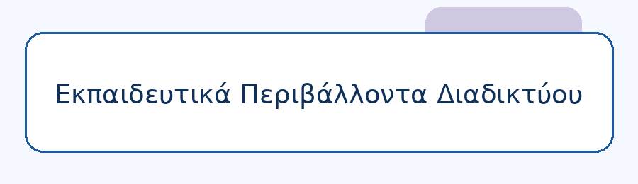

# Course Management Website

A university coursework project that develops a course website in two stages: a static HTML/CSS website and a dynamic PHP/MySQL application with authentication and Tutor/Student roles. The interface and sample course content are in Greek.



## Features

- Five course sections: home, announcements, contact, documents, and homework.
- Shared CSS, image-based navigation, and a responsive layout.
- Session authentication with hashed passwords and separate Tutor/Student permissions.
- Tutor management of users, announcements, documents, and homework.
- Document uploads and authenticated downloads.
- Automatic announcement when a new homework assignment is created.
- Contact messages stored in the database, with optional email delivery to tutors.

## Repository structure

| Location | Contents |
| --- | --- |
| `part-a/` | Original five-page static website, CSS, images, and sample downloads |
| `part-b/` | PHP application, shared helpers, forms, upload storage, and access rules |
| `database/schema.sql` | Database schema and three fictional demo accounts |
| `tests/` | Static-resource checks and local HTTP integration tests |

## Run Part A

Open `part-a/index.html` directly, or serve the static folder from the repository root:

```sh
python3 -m http.server 8001 --bind 127.0.0.1 --directory part-a
```

Open <http://127.0.0.1:8001>. The static contact form uses `mailto:` and requires an email client. The example address is fictional.

## Run Part B

Requirements: PHP 8.1 or newer, the `mysqli` extension with `mysqlnd`, and MySQL or MariaDB. Verification used PHP 8.3.6 and MariaDB 10.11.14.

1. Create a **new, empty** database and an application database user using your database administration tool. For example, run the following as a database administrator, replacing the placeholder password:

   ```sql
   CREATE DATABASE course_portal CHARACTER SET utf8mb4 COLLATE utf8mb4_unicode_ci;
   CREATE USER 'course_app'@'127.0.0.1' IDENTIFIED BY 'YOUR_LOCAL_PASSWORD';
   GRANT ALL PRIVILEGES ON course_portal.* TO 'course_app'@'127.0.0.1';
   ```

2. Copy `part-b/config.example.php` to `part-b/config.local.php` and set your database password and connection settings. The local configuration is ignored by Git. Environment variables with the same names are also supported when a local override has not defined them.

3. From the repository root, initialize the demo data:

   ```sh
   php part-b/setup.php --initialize-demo
   ```

   Setup runs only from the command line and refuses a database that already contains tables. An interrupted import can leave a partial database; use a fresh empty demo database before retrying.

4. Start the local server **with the router**:

   ```sh
   php -S 127.0.0.1:8000 -t part-b part-b/router.php
   ```

5. Open <http://127.0.0.1:8000/login.php> and sign in with a demo account.

### Demo accounts

| Role | Email | Password |
| --- | --- | --- |
| Tutor | `tutor@example.test` | `TutorDemo123!` |
| Student A | `student.a@example.test` | `StudentADemo123!` |
| Student B | `student.b@example.test` | `StudentBDemo123!` |

These accounts are public demonstration data. Use them for local demonstrations and replace them before a public deployment.

### Email and files

Contact messages are saved even when email delivery is disabled. `MAIL_ENABLED` defaults to false. Enable it only with a configured PHP mail transport and appropriate tutor email addresses. `CONTACT_EMAIL` controls the separate email link.

Tutor uploads accept PDF, DOC, DOCX, TXT, ODT, PPT, and PPTX files up to 10 MB. Configure PHP's `upload_max_filesize` to at least `10M` and `post_max_size` to at least `12M` for that limit. The `part-b/uploads/` directory must be writable by PHP. Runtime uploads and local credentials are excluded from the public repository.

The router prevents direct access to uploads, course downloads, configuration, and helpers. For Apache 2.4, use `part-b/` as the document root and enable the included `.htaccess` rules (`AllowOverride All` and `mod_rewrite`). Verify the access rules on the actual server. Other servers need equivalent access restrictions.

## Checks

From the repository root:

```sh
python3 tests/check_static.py
```

With Part B running against a disposable local demo database, and `MAIL_ENABLED` disabled:

```sh
python3 tests/smoke.py http://127.0.0.1:8000
```

The HTTP tests create and remove temporary CRUD records and store one test contact message. Uploaded test files can remain in local storage after their database records are removed.

## Contributors

- Αριστοτέλης Κασσελούρης

for the "Educational Web Environments" course.
